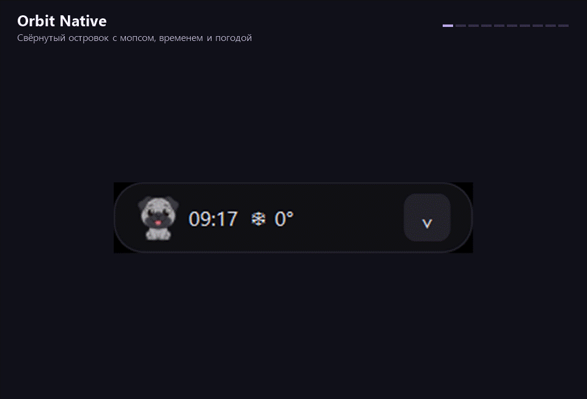

# Orbit Native



Экспериментальный перенос [Orbit](https://github.com/TrashDokiDoki/Orbit) на C++17 и Qt Widgets для Windows и Linux. Нативная сборка использует виджеты Qt и не запускает Electron, Node.js, браузерный движок или PowerShell. История исходного проекта сохранена в репозитории. Старый интерфейс находится в `resources/app`; нативная цель использует оттуда только изображения.

## Установка

В [Releases](https://github.com/TrashDokiDoki/Orbit-Native/releases) публикуются два пакета x64. На Windows запустите `OrbitNative-0.2.0-windows-x64.exe`. На Ubuntu 24.04 установите `orbit-native_0.2.0_amd64.deb` командой `sudo apt install ./orbit-native_0.2.0_amd64.deb`. Откройте Orbit Native из меню приложений. Совместимость с другими дистрибутивами зависит от версий Qt и системных библиотек.

## Что доступно

- Свёрнутый островок с часами, погодой и мопсом. Панель раскрывается по кнопке или наведению.
- Лаунчер Spotify, ChatGPT и Codex, полка файлов с перетаскиванием, заметка, таймер и разовые или ежедневные напоминания.
- Почасовой и недельный прогноз Open-Meteo, преобразование текста, история текстового буфера по согласию пользователя и сохранение снимка монитора на Windows и X11.
- На Linux плеер получает название, исполнителя и локальную обложку через [MPRIS](https://specifications.freedesktop.org/mpris/latest/Player_Interface.html). На Windows работают системные медиаклавиши. Название и обложка на Windows ещё не перенесены.
- На Wayland положение окна и режим поверх остальных зависят от композитора. Для точного расположения сверху используйте X11 или правило окна вашего композитора.
- Синхронные тексты, запись экрана, OCR, QR, управление системным звуком, VPN и вкладка сетевых инструментов пока остаются в исходном Orbit. Снимок экрана под Wayland потребует отдельного адаптера портала.

В ветке разработки добавлены несколько заметок с переносом старой записи, пауза таймера и восстановление таймера после перезапуска. GIF показывает опубликованный Preview 0.2.0.

## Сборка

Нужны компилятор C++17, CMake 3.21+ и Qt 6.4+ с Widgets и Network. На Linux нужен модуль Qt DBus.

На Ubuntu 24.04:

```bash
sudo apt install build-essential cmake qt6-base-dev qt6-qpa-plugins
cmake -S . -B build -DCMAKE_BUILD_TYPE=Release
cmake --build build --parallel
ctest --test-dir build --output-on-failure
./build/OrbitNative
```

На Windows откройте терминал Visual Studio с C++ и установите Qt для MSVC. Укажите путь к установленному комплекту Qt через `CMAKE_PREFIX_PATH`:

```powershell
cmake -S . -B build -A x64 -DCMAKE_PREFIX_PATH=C:/Qt/6.8.3/msvc2022_64
cmake --build build --config Release --parallel
ctest --test-dir build --build-config Release --output-on-failure
windeployqt --release build/Release/OrbitNative.exe
build/Release/OrbitNative.exe
```

Для создания пакета запустите `cpack --config build/CPackConfig.cmake -B package` на Linux или добавьте `-C Release` на Windows с установленным NSIS. Первые пакеты рассчитаны на x64. Для ARM64 нужны отдельные Qt SDK и проверка на устройстве. Настройки Orbit Native сохраняются отдельно. Погода использует Open-Meteo, лаунчер открывает ссылки в браузере по нажатию.

[Лицензия Orbit](resources/app/LICENSE)

## Перенос интерфейса Orbit 0.3.3

Экспериментальная цель `OrbitShell` загружает исходные HTML, CSS, JavaScript и изображения Orbit. На Windows она использует системный WebView2, на Linux — GTK 3 и WebKitGTK 4.1. Qt обслуживает данные и запросы, медиаклавиши Windows и MPRIS Linux остаются в отдельных адаптерах.

```bash
cmake -S . -B build -DORBIT_WEB_SHELL=ON -DCMAKE_BUILD_TYPE=Release
cmake --build build --target OrbitShell --parallel
```

Для Linux дополнительно нужны `libgtk-3-dev` и `libwebkit2gtk-4.1-dev`, для Windows — WebView2 Runtime. Цель загружает закреплённую версию webview 0.12.0 при конфигурации. Обычная сборка и установщики пока используют Qt Widgets. В экспериментальной оболочке подключены настройки, лаунчер, заметки, таймер, напоминания, погода, полка, текстовая история буфера и базовое управление воспроизведением. Захват монитора на Windows и X11 открывает исходный редактор с разметкой, пипеткой и QR. Для OCR нужен Tesseract в PATH. Для захвата под Wayland ещё нужен адаптер системного портала. Звук использует Core Audio в Windows и PulseAudio либо PipeWire-Pulse в Linux. Ползунок, отключение звука и выбор выхода имеют общий интерфейс. Редактор эквалайзера сохраняет профиль Equalizer APO; его применение зависит от системного эквалайзера. «Управление» читает состояние сети, Bluetooth и темы. Питание и блокировка используют Win32 или systemd-logind. Изменение системной темы Linux поддерживает GNOME, а системный голосовой ввод — Windows. Во вкладке «Сеть» Orbit управляет установленной службой Zapret и выбранным процессом TG WS Proxy. Happ открывается по системной ссылке; индикатор видит туннель, а определение режима системного прокси ещё переносится. Остальные вызовы показывают сообщение о незавершённом переносе. Геометрия окна под Wayland зависит от композитора. Полное совпадение системных функций и рендера на разных ОС ещё предстоит проверить.

### Установщики WebView Preview

[Скачать Windows EXE и Ubuntu DEB](https://github.com/TrashDokiDoki/Orbit-Native/releases/tag/v0.3.0-shell-preview).

Сборки с `-DORBIT_WEB_SHELL=ON -DORBIT_PACKAGE_SHELL=ON` выпускают отдельный пакет предварительной версии. Windows x64 получает NSIS-установщик с библиотеками Qt. При отсутствии WebView2 установщик сам запускает подписанный загрузчик Microsoft. Для загрузки рантайма нужен интернет. Сборщику Windows нужно передать `-DORBIT_WEBVIEW2_BOOTSTRAPPER=<путь к подписанному EXE Microsoft>`.

Для Ubuntu 24.04 x64 пакет `.deb` объявляет зависимости Qt, WebKitGTK и OCR. Откройте его в менеджере пакетов с поддержкой установки локальных DEB или выполните `sudo apt install ./orbit-native-shell_0.3.0_amd64.deb`. Пакеты Linux используют системные библиотеки. OCR на Windows в этой предварительной сборке пока требует Tesseract в PATH.

WebView Preview добавлен в меню приложений отдельно от Qt Widgets. В нём работает проверка стабильных релизов GitHub, значок в трее при наличии системного трея и экспорт данных из настроек. Совместимость пакетов на Windows 10, Windows ARM64 и других дистрибутивах Linux ещё предстоит проверить.
